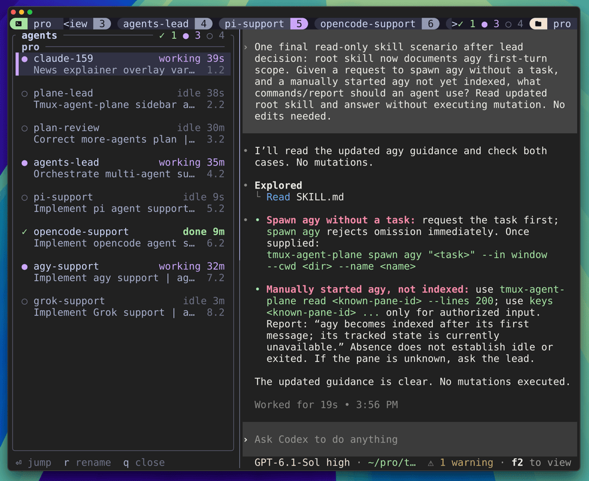

# tmux-agent-plane

<p align="center">
  <a href="https://github.com/zazencodes/tmux-agent-plane/actions/workflows/ci.yml"></a>
  <a href="https://crates.io/crates/tmux-agent-plane"></a>
  <a href="https://github.com/zazencodes/tmux-agent-plane/releases/latest"></a>
  <a href="LICENSE"></a>
  
  
</p>

<p align="center">
  
  
  <a href="https://zazencodes.com/"></a>
</p>

See and steer every coding agent running in your tmux.

Start Claude Code, Codex or Antigravity (`agy`) in any tmux pane, the way you already do. Add Pi, OpenCode or Grok Build with the opt-in integrations below. tmux-agent-plane finds it, tracks whether it is working, waiting on you, or done, and shows that in your status bar and in an agent list. Your agents get the same view through a CLI and an agent skill, so any agent can check on, message, wait for or start other agents, and one agent can run the rest as a super agent.

Claude Code, Codex and Antigravity use native signals. Pi and OpenCode use publishers built on their official extension APIs; Grok Build uses its official leader mode. Each optional integration has one setup step under [More agents](#more-agents).

<p align="center">
  
</p>

## Features

- **Every agent, every session.** One daemon watches every pane in every tmux session and keeps a single index of the agents in them: name, state, task, location and working directory.
- **Know what needs you.** The status bar counts agents by state. An agent that finishes or blocks while you are looking elsewhere shows a five-second notice in every open sidebar footer and sends a desktop notification, and stays `done` until you look at it.
- **A sidebar of agents.** `prefix + S` opens a live list of every agent down the left of every window, in every session, and puts you in it: state, time in that state, task and location. `Enter` jumps to an agent, and the sidebar is there too. Close it once and it closes everywhere.
- **Peek before you jump.** `prefix + A` opens the agent list in a popup with a large live preview of the selected agent's screen.
- **Agents that know about each other.** The `tmux-agent-plane` CLI and agent skill let any agent list, read, message, answer, wait for, show, close and spawn other agents.
- **Names you can read.** Agents name themselves after their task when they use the skill, name the agents they spawn, and you can rename any agent from the sidebar with `r`.
- **Super agents.** One agent can spawn helpers in new panes, windows or sessions, hand each a task, wait for the results and report back. A spawned agent records its parent when caller identity is known.
- **Your agents, unchanged.** Spawned agents start in a normal shell, so your aliases and flags apply, and the shell stays when the agent exits.

## States

| State | Meaning |
| --- | --- |
| ● `working` | running a turn |
| ◆ `blocked` | waiting on you: a question, a permission prompt, a dialog |
| ✓ `done` | finished a turn you have not looked at yet |
| ○ `idle` | ready for input, already seen |

## Requirements

- tmux 3.3 or newer
- At least one supported agent CLI: Claude Code, Codex, Antigravity, Pi, OpenCode or Grok Build
- `lsof` for Antigravity process/session association (included with macOS; install it on Linux when using agy)
- Rust and a C compiler, to build it (SQLite is bundled)
- macOS or Linux. Desktop notifications use `osascript` on macOS and `notify-send` on Linux.

## Install

**1. The binary.**

```sh
cargo install --locked tmux-agent-plane
```

**2. The tmux plugin.** With [TPM](https://github.com/tmux-plugins/tpm), add to `~/.tmux.conf` and press `prefix + I`:

```tmux
set -g @plugin 'zazencodes/tmux-agent-plane'
```

Without TPM, clone the repo and add `run-shell /path/to/tmux-agent-plane/tmux-agent-plane.tmux` to `~/.tmux.conf`.

The plugin starts the daemon once the first session exists, binds `prefix + S` to the sidebar and `prefix + A` to the agent list popup, and sets a `session-created[90]` hook to start the watcher and `session-window-changed[90]` and `client-session-changed[90]` hooks that bring the open sidebar to each window you visit. To use another sidebar key, set it before the plugin loads:

```tmux
set -g @agent-plane-sidebar-key Space   # replaces tmux's next-layout binding
```

**3. The status bar.** Add `#{@agent_plane_status}` to `status-right` (or `status-left`):

```tmux
set -g status-right "#{@agent_plane_status}%H:%M"
```

**4. The skill.** Link it into each agent's skills folder. With TPM the repo is in `~/.tmux/plugins/tmux-agent-plane`:

```sh
ln -s ~/.tmux/plugins/tmux-agent-plane/skill/tmux-agent-plane ~/.claude/skills/tmux-agent-plane   # Claude Code
ln -s ~/.tmux/plugins/tmux-agent-plane/skill/tmux-agent-plane ~/.agents/skills/tmux-agent-plane   # Codex
```

**5. Tell your agents.** Agents reach for raw tmux commands out of habit, even with the skill installed. One line in your global `~/.claude/CLAUDE.md` and `~/.codex/AGENTS.md` fixes that:

```markdown
- Coding agents in my tmux are indexed by `tmux-agent-plane`. Whenever a task touches another agent (checking on, reading, messaging, waiting for, showing, closing or spawning one), load the `tmux-agent-plane` skill first and use its CLI; never drive agent panes with raw tmux commands.
```

## More agents

Tested with Pi 1.0.2, OpenCode 1.19.3 and Grok Build 1.0.70. Pi/OpenCode must inherit the daemon's `XDG_STATE_HOME`.

These integrations are independent. Install only the ones you use; absent publisher files or a Grok leader socket leave that kind untracked. The paths below assume a TPM checkout at `~/.tmux/plugins/tmux-agent-plane`.

- **Pi:** symlink its publisher into Pi's extension directory, then restart Pi:

  ```sh
  mkdir -p "${PI_CODING_AGENT_DIR:-$HOME/.pi/agent}/extensions"
  ln -s "$HOME/.tmux/plugins/tmux-agent-plane/extensions/pi" "${PI_CODING_AGENT_DIR:-$HOME/.pi/agent}/extensions/tmux-agent-plane"
  ```

- **OpenCode:** symlink the TUI publisher plugin and add `"./tmux-agent-plane.js"` to the `plugin` array in `~/.config/opencode/tui.json` (or your `$XDG_CONFIG_HOME/opencode/tui.json`), preserving existing entries. Restart OpenCode. [Example configuration](extensions/opencode/tui.example.json).

  ```sh
  mkdir -p "${XDG_CONFIG_HOME:-$HOME/.config}/opencode"
  ln -s "$HOME/.tmux/plugins/tmux-agent-plane/extensions/opencode/tmux-agent-plane.js" "${XDG_CONFIG_HOME:-$HOME/.config}/opencode/tmux-agent-plane.js"
  ```

- **Grok Build (macOS):** add `use_leader = true` to the existing `[cli]` table in `~/.grok/config.toml` (or `$GROK_HOME/config.toml`), then restart Grok sessions. [Example configuration](extensions/grok/config.toml.example). The daemon uses the same `GROK_HOME` and `GROK_LEADER_SOCKET` overrides as Grok; its default socket is `~/.grok/leader.sock`.

## Usage

Run your agents as usual. Then ask any of them things like:

- "What agents are running?"
- "How is codex-164 doing?"
- "Answer reviewer's question: yes, apply it."
- "Spawn a Codex agent in a new window to migrate the billing tests, and tell me when it's done."
- "You're the super agent: split this refactor across three agents, one per package, and review their work."

### Sidebar and agent list

| Key | Action |
| --- | --- |
| `prefix + S` | Open the sidebar in every window and move into it; close it everywhere when it is open |
| `prefix + A` | Open the agent list popup, with a preview |
| `j` `k` / `↓` `↑` | Move selection; in sidebar view mode, preview the selected agent’s window/session |
| `v` | Toggle sidebar view mode (off initially): preview while keeping keyboard input in the sidebar |
| `s` | Re-sort agents within each session by attention, then longest in state; keep the selected pane |
| `f` | Cycle sidebar state filter: All → Blocked → Done → Working → Idle → All, skipping states with no search matches when pressed |
| `/` | Edit sidebar search across name, task, blocked detail, location and directory; matches ignore case. `Enter` keeps the query and previews its selection when view mode is on, `Esc` cancels the edit, `Ctrl-W` deletes a word, `Ctrl-U` clears; arrows move selection while editing |
| `Esc` | Clear sidebar search outside editing; close the popup |
| `Enter` | Jump to the agent. The sidebar stays open; the popup closes |
| `x` | Ask to kill the selected agent’s pane. The footer pins its name/state; `Enter` or lowercase `y` confirms, every other key cancels without replay. Refuses to end your attached session; warns if a remote session would end |
| `r` | Rename the agent (sidebar), starting from its current name. `Ctrl-W` deletes a word, `Ctrl-U` clears, `Enter` saves, `Esc` cancels |
| `q` | Close: the sidebar everywhere, or the popup (also `Esc`) |

An agent in a linked window has one index row, displayed under the first session by name. It counts as visible when its pane is visible through any link.

While the sidebar is open, every window has one, including windows and sessions you create later; each keeps its own selection. A window's sidebar closes with the window: when its other panes are gone, it goes too. The sidebar and popup start on the first blocked agent, or else the first done one. The agent you are looking at is shown in bold in the sidebar.

View mode starts off. With `v` on, moving with arrows or `j`/`k` previews the selected agent's window/session and keeps keyboard input in its sidebar. The sidebar pane itself moves into the previewed window, so selection, view mode, filter, search and order stay exactly as they were, and the sidebar it swapped with takes its place in the window you left. `v` again returns to selecting without preview. Preview keeps the sidebar active, so a done agent remains unseen; `Enter` focuses it and makes it seen, and the sidebar moves with you the same way when view mode is off. Navigation requires a unique client in the input sidebar and refuses a destination session/window used by another client.

Session headings stay in place. Within each session, agents start in blocked, done, working, idle order, longest in state first. The order is latched: rows never move on their own, so badges and ages update in place, new agents append in their group, and removed agents disappear. Only `s` re-sorts, preserving the selected pane. Each sidebar keeps its own order.

The view/filter/query controls stay visible above the list. Filters and search combine; a filter stays selected if its last match changes state or exits, until you press `F` again. Search updates as you type and pauses view mode, including arrow navigation, so editing stays in the current sidebar. With `v` on, the mode row shows `paused` and the footer offers `Enter` to preview. `Enter` keeps the query and previews the final selection when view mode is on; another `Enter` deliberately jumps to the selected agent. `Esc` while editing restores the previous query and selection; outside editing it clears search. While editing, letters such as `V`, `F`, `r` and `q` are query text.

`x` closes the agent's pane using the same operation as `tmux-agent-plane kill`. It does not issue `kill-session`. The confirmation takes priority over notices and event footers, with separate name/state lines in narrow sidebars. It is pinned to the target's native identity and state; an exited, changed or renamed agent requires a new confirmation. After a successful kill, selection moves to the next visible agent (or the previous one at the end). Killing a final pane may naturally remove its window; if that would also end a remote session, the prompt names the session. Ending the originating client's attached session is refused.

### Notifications

When an agent finishes or blocks off screen, every open sidebar shows the latest transition on its bottom line for five seconds: `✓ grok-support done` in green or `◆ grok-support blocked` in red. Sidebars in other windows and sessions receive the same event. Rename errors and active rename controls take priority; normal key hints return when the notice expires. A notice never opens a closed sidebar, changes focus or intercepts pane input. Expired notices are discarded, and restarting the daemon clears the previous notice.

Pi and OpenCode completion counters also report a new finished turn when it completes between polls while the agent still shows `done`. Each new completion follows the same footer and desktop policy.

Desktop notifications keep the task or blocked detail and work with the sidebar closed. Daemon faults and recoveries appear in a short popup under the status bar, opened on each client once you pause typing for three seconds (a tmux popup takes keyboard input while open); active faults remain in the status bar and full reasons are recorded in `daemon.log`.

### Agent launch syntax

`spawn` starts a persistent interactive session in tmux’s configured `default-shell`. It passes the launch command directly to an interactive login shell, which loads your startup files before running the agent, so aliases and flags apply even with long or multi-line tasks. Each argument is quoted separately. When the agent exits, a fresh interactive login shell stays open. `spawn` supplies its own launch command, so tmux’s `default-command` is not used.

| Kind | Command sent to the shell with a task |
| --- | --- |
| `claude` | `claude '<task>'` |
| `codex` | `codex '<task>'` |
| `pi` | `pi -- '<task>'` |
| `opencode` | `opencode --prompt '<task>'` |
| `agy` | `agy --prompt-interactive '<task>'` |
| `grok` | `grok -- '<task>'` |

All kinds except agy can be spawned without a task. `spawn agy` requires a task and fails immediately if it is missing: agy publishes no state until its first turn. An agy started by hand appears once you send its first message; before then, use `read <pane-id>` and `keys <pane-id> ...`. Pi and OpenCode need their opt-in publisher installed before `spawn` can detect them; Grok needs leader mode.

### CLI

| Command | Action |
| --- | --- |
| `list [--json]` | All agents. `*` (or `"self": true`) marks a known caller |
| `read <agent> [--lines N]` | The agent's screen, plus N lines of scrollback |
| `send <agent> "<prompt>" [--answer] [--wait] [--timeout S]` | Paste a prompt and press Enter. Refuses blocked agents unless `--answer` deliberately replies to their question; `--answer` requires a blocked target. `--wait` follows the submitted turn until it ends or blocks |
| `keys <agent> <key>...` | Press keys, by tmux key name: `Enter`, `Escape`, `Down`, `2` |
| `wait <agent> [--timeout S]` | Wait until the agent is not working |
| `rename <agent> <name>` | Name an agent: one word, unique. `self` requires a known caller |
| `focus <agent>` | Show the agent on your screen |
| `kill <agent>` | Close the agent's pane |
| `spawn claude\|codex\|pi\|opencode\|agy\|grok ["<task>"] [--in pane\|window\|session] [--cwd DIR] [--name NAME] [--wait] [--timeout S]` | Start an agent. `--in pane` (default) splits the caller's pane |
| `toggle-sidebar <window>` | What the sidebar key does, from a window (a window or pane id) |
| `follow-sidebar <window>` | Add the sidebar to a window while it is open. The plugin runs it when a window comes on screen |
| `sidebar` | The sidebar's agent list, run in the sidebar pane |
| `ui` | The agent list popup |
| `daemon start` | Start the detached watcher; the plugin runs this automatically |
| `daemon restart` | Gracefully restart the watcher using the current binary |
| `daemon stop` | Gracefully stop the watcher |

`<agent>` is an agent's name, tmux pane id, or `self` when the caller can be identified. An agent is `<kind>-<pane number>` (`claude-154`) until it is named with `spawn --name`, `rename`, or `r` in the sidebar. The name is stored on the agent's tmux pane. `read` and `keys` also take any pane id, so an agent stuck on a prompt before it starts can still be answered.

Read a blocked question before replying: `tmux-agent-plane read reviewer`, then `tmux-agent-plane send reviewer --answer "Use the existing naming convention"` when the user's instructions make that answer clear. Use `keys` for menus and permissions. Check `list` before status or escalation messages; defer them or report through an available lead if the target is blocked. Status and escalation messages must never use `--answer`, and a refusal must never automatically retry with that flag.

## How it works

- **Claude Code** keeps `~/.claude/sessions/<pid>.json` for each running session, with its tmux pane and a `status`: `busy`, `waiting` (with `waitingFor`, such as `input needed`), `idle`, or `shell` (the turn is over and a background shell runs on).
- **Codex** sets the terminal title: a braille spinner in front while a turn runs, `[ ! ] Action Required` while an approval or question waits. A pane is a Codex agent when exactly one top-level `codex` process runs under it, and no Claude Code process sits above it.
- **Antigravity** publishes its active conversation through the process's open presence file. Live SQLite summaries and their background-task flag distinguish working from fully idle; current-turn pending interactions take priority and distinguish permission and question waits. The reader includes SQLite so it reads active WAL data correctly.
- **Pi** publishes PID, pane, native session, live activity, UI prompts, and completed-turn counts through the opt-in extension in `extensions/pi/`.
- **OpenCode** publishes its active TUI session and native status, permission and question snapshots through the opt-in TUI publisher plugin in `extensions/opencode/`. Its default TUI has no external HTTP listener.
- **Grok Build** uses the official leader roster's `working`, `needs_input` and `idle` states. Native active-session records tie each local resident session to its live TUI process. The blinking terminal title is not used for state.
- **The daemon** scans all enabled kinds once a second for every pane on the tmux server. It marks a turn that ends off screen as `done` until the pane is on screen, writes the index to `~/.local/state/tmux-agent-plane/agents.json`, sets the `@agent_plane_status` tmux option, and sends notifications. It runs detached from tmux jobs, exits with the tmux server, and starting it again keeps the existing watcher. Lifecycle and daemon errors are appended to `daemon.log` alongside the index (`$XDG_STATE_HOME/tmux-agent-plane/daemon.log` when set).
- **The CLI and the agent list** read the index. They fail with a clear error when the daemon is not running.
- **`send`** pastes with bracketed paste, then presses Enter, so a multi-line prompt arrives as one message.

## Notes

- Pi and OpenCode are opt-in. Without their publisher status files, those kinds remain untracked and require no setup. A live opted-in publisher with malformed, unknown or stale status fails loudly; dead process files are ignored.
- Pi and OpenCode publish durable completion counters, so waits observe turns that finish between daemon polls. Claude Code, Codex, agy and Grok are sampled: a turn entirely between polls can be missed by `send --wait` or `spawn --wait`.
- Codex tool shells may inherit a stale `TMUX_PANE` from a shared app-server. `list` works and marks no caller; `spawn --in window` and `--in session` work with `parent: null`. Self references, inherited-pane targets and `spawn --in pane` fail with a clear error. Use explicit agent names and window/session spawning.

- Antigravity appears after its first message and native folder trust acceptance. Named projects (including resumed/forked projects) and `--settings` overlays excluding the cwd from `trustedWorkspaces` stay untracked because live trust cannot be proven.
- A Claude Code session is detected once it writes its session file, after the folder trust prompt. When `spawn` reports that an agent did not start, read its pane and answer the prompt with `keys`.
- Codex detection relies on its default terminal title. A `tui.terminal_title` setting that drops the activity spinner hides the `working` state.
- An unknown, malformed or stale live state withdraws the affected kind or agent from the index. Other kinds keep tracking; the status bar shows the fault and `daemon.log` records its full reason and recovery. Errors reading the process/pane snapshot or writing the index/log stop the watcher.
- After upgrading, run `tmux-agent-plane daemon restart`. This stops the managed watcher through its private control socket, waits for its index lock to release, then starts the current binary. `daemon stop` stops it without a replacement. Startup failures and SIGTERM exits are recorded in `~/.local/state/tmux-agent-plane/daemon.log` (under `$XDG_STATE_HOME` when set).
- Only the default tmux server is watched.

## Changelog

See [CHANGELOG.md](CHANGELOG.md). Releases are tagged `vX.Y.Z`.

## License

[GPLv3](LICENSE). You can use, modify and share this code, and any version you distribute must also be released under GPLv3.

<p align="center">
  <a href="https://zazencodes.com/?utm_source=github&utm_medium=referral&utm_campaign=tmux-agent-plane">
    
  </a>
  <br>
  Created by <a href="https://zazencodes.com/">ZazenCodes</a>
</p>
